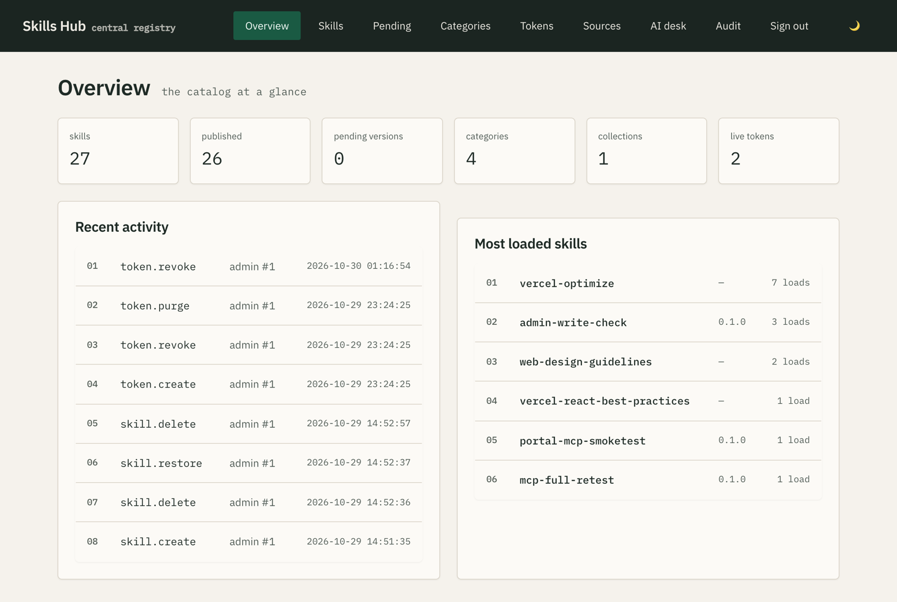
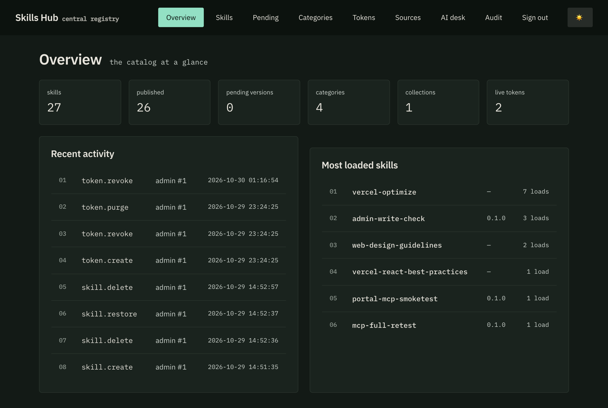
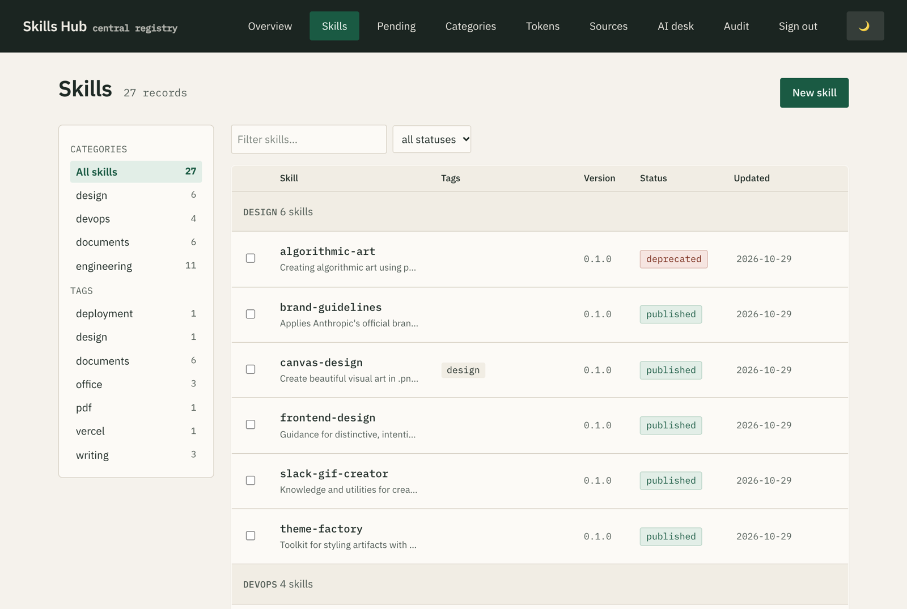
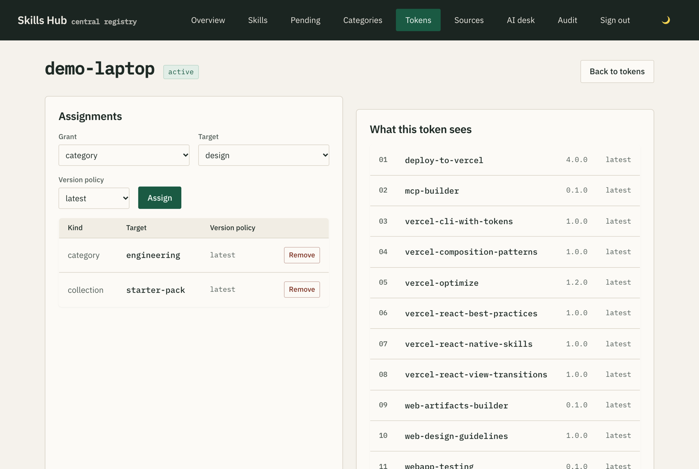

# Skills Hub

One self-hosted registry for agent skills (`SKILL.md` folders). Serve curated
skills to any MCP-capable agent with **per-token visibility**, manage everything
from a web UI, and import from any GitHub repo the way `npx skills` does.

**One process, one SQLite file, one volume.** No native deps, no external
database.

| Overview | Dark mode |
|---|---|
|  |  |
| **Skills ledger** | **Token scoping** |
|  |  |

[](https://github.com/bacnh85/skills-hub/actions/workflows/docker.yml)

## What it does

- **Admin web UI** — skills, categories, collections, tags, tokens, sources,
  AI-assisted organisation, and a full audit log. Light and dark themes.
- **MCP server** at `/mcp` — five tools with three-tier progressive disclosure,
  so agents fetch only what they need.
- **Per-token visibility** — issue one token per project or machine; each token
  sees only what you assign to it.
- **Import pipeline** — point it at `owner/repo` or a URL; every import is
  linted and scanned for prompt injection before it lands.
- **Client HTTP** — `GET /s/<name>/SKILL.md`, `GET /s/<name>.tgz`,
  `GET /c/<collection>.tgz`, compatible with `npx skills add`.

## Quick start (Docker Compose)

```bash
mkdir skills-hub && cd skills-hub
curl -O https://raw.githubusercontent.com/bacnh85/skills-hub/main/docker-compose.yml
docker compose up -d
docker compose logs | grep "Admin token" -A 2   # shown once on first boot
```

Open `http://localhost:8787/ui/index.html`, paste the admin token, done.
Prefer a fixed token? Set `ADMIN_TOKEN` in `docker-compose.yml` before first boot.

To build locally instead of pulling:

```bash
git clone https://github.com/bacnh85/skills-hub && cd skills-hub
# uncomment "build: ." in docker-compose.yml
docker compose up -d --build
```

### Run from source (Node 22+)

```bash
npm install
npm run build
npm start            # prints a generated admin token on first boot
```

## Connect an agent

Issue a client token in the UI (**Tokens → Issue**), assign what it may see,
then wire up your agent:

```bash
claude mcp add skills-hub --transport http \
  --header "Authorization: Bearer ct_…" \
  http://localhost:8787/mcp
```

Or install a skill directly with the standard CLI — no MCP setup needed:

```bash
npx skills add http://localhost:8787/s/pdf-report.tgz?token=ct_…
```

## How visibility works

A token sees **only** what you assign:

- a **category** (all its skills), a **collection** (a named bundle), or a
  **single skill**
- each assignment carries a version policy: `latest`, `major:N`, or `exact:X.Y.Z`
- when several apply, the most specific wins: **skill > collection > category**

The token detail page shows a live *"what this token sees"* preview, so you
never have to guess what an agent will get.

Tokens with `skills:write` can propose skills over MCP. Proposals are stored
**pending** and stay invisible until an admin approves them.

## Importing skills

Sources accept what `npx skills` accepts: `owner/repo`, GitHub/GitLab URLs
(including `/tree/<ref>/<subpath>`), direct `.tgz` URLs, and local paths.

Every import is scanned before it lands:

- malformed frontmatter is rejected outright by the linter (score + diagnostics)
- prompt-injection and credential patterns force the skill to `draft` with flags
  visible on its record
- re-importing unchanged content is a no-op (no version churn)

Use **Preview only** to inspect a source without storing anything.

## MCP tools

| Tool | Tier | Purpose |
|---|---|---|
| `skills_list` | 1 | name, version, description of assigned skills |
| `skills_search` | 1 | keyword match over your visible set |
| `skills_get` | 2 | full `SKILL.md` + bundled-file manifest |
| `skills_get_file` | 3 | one `references/`, `assets/` or `scripts/` file (text; never executed) |
| `skills_create` | — | propose a skill/version (requires `skills:write`; lands pending) |

## AI desk

Optional. Runs advisory jobs against any OpenAI-compatible endpoint (Ollama
works): sort uncategorised skills into categories, review duplicate pairs,
rewrite weak descriptions. Results are proposals in the UI with explicit Apply
buttons — the model never mutates the registry directly.

## Configuration

| Env | Default | Meaning |
|---|---|---|
| `PORT` | `8787` | listen port |
| `DB_PATH` | `./data/portal.db` | SQLite file (the whole registry) |
| `ADMIN_TOKEN` | generated | fixed admin token; otherwise printed once at first boot |
| `PUBLIC_SKILL_ACCESS` | `false` | allow unauthenticated reads of published skills |
| `AI_BASE_URL` | — | OpenAI-compatible endpoint (e.g. `http://localhost:11434/v1` for Ollama) |
| `AI_API_KEY` | — | optional |
| `AI_MODEL` | — | model name for the configured endpoint |
| `GITHUB_TOKEN` | — | raises GitHub API limits and enables private repos |

## Security notes

- Everything requires a bearer token by default; the only public endpoint is
  `/healthz`.
- Client tokens are shown **once** at creation and stored hashed; revoke or
  purge them anytime.
- Skill bundle files are served as text only — scripts are never executed
  server-side.
- The server speaks plain HTTP. Put a TLS reverse proxy (Caddy/nginx) in front
  before exposing it beyond a trusted network, or bearer tokens travel in
  clear text.

## Develop

```bash
npm run dev     # tsx, no build step
npm test        # 14 end-to-end tests against a live server
```

Design system: [`DESIGN.md`](DESIGN.md). Research notes and the reasoning
behind each trust boundary: [`docs/research.md`](docs/research.md).
